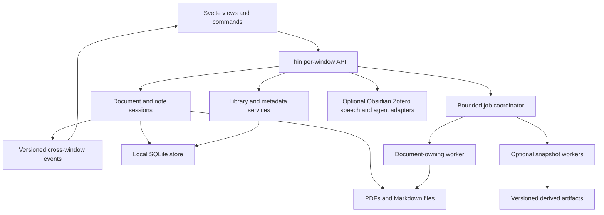

# PhDF: improvement and future expansion research

Research date: 2026-10-16. Project baseline: v0.6.0.

This is a discovery and preparation document, not an implementation commitment. It answers
two questions: how to improve what PhDF already does, and what to add after that foundation
is dependable. Recommendations reflect the current repository, primary technical sources,
and documented workflows in other readers. They are not evidence of market demand.

## Contents

1. [Direction and recommended decisions](#1-direction-and-recommended-decisions)
2. [Evidence, limitations, and current structure](#2-evidence-limitations-and-current-structure)
3. [Step 1: improve the existing program](#3-step-1-improve-the-existing-program)
4. [Step 2: additions worth considering](#4-step-2-additions-worth-considering)
5. [Architecture and data preparation](#5-architecture-and-data-preparation)
6. [Performance and validation plan](#6-performance-and-validation-plan)
7. [Priorities and delivery sequence](#7-priorities-and-delivery-sequence)
8. [Research spikes and decisions still needed](#8-research-spikes-and-decisions-still-needed)
9. [Source register](#9-source-register)

## 1. Direction and recommended decisions

PhDF's strongest direction is a local desktop workspace for reading, extracting evidence,
and writing connected notes. The combination of ordinary PDFs, ordinary Markdown, position
memory, source-linked quotes, and the user's terminal AI is already coherent. Expansion
should make that loop better before adding unrelated document-authoring features.

Recommended sequence:

1. Make saving, closing, document identity, note ownership, and derived caches dependable.
2. Establish performance measurements and a safe background-processing model.
3. Improve text selection, navigation, annotation interoperability, and Markdown fidelity.
4. Add durable links, collections, metadata, and search across documents.
5. Connect Obsidian and Zotero through small, optional adapters.
6. Add study, speech, and research-comparison workflows when they can reuse those foundations.

Keep the current Python, pywebview, Svelte, and SQLite stack for now. There is no measured
evidence here that a framework rewrite would solve PhDF's main problems. Keep native PDF
annotations and human-readable notes as durable outputs. Keep large models, cloud accounts,
and optional integrations out of the basic reading path.

The best near-term additions are **page labels, durable source links, library tags and
collections, local full-text search, and better citation metadata**. These improve daily
reading and enable later research features without requiring a hosted service.

The largest technical discovery is that the current background-work explanation needs
revision. PyMuPDF explicitly warns against concurrent multithreaded use; a separate document
copy does not establish thread safety. A bounded process-based design deserves a prototype.
This is a documented architectural constraint, not a reproduced crash diagnosis.
[PyMuPDF multiprocessing documentation](https://pymupdf.readthedocs.io/en/latest/recipes-multiprocessing.html)

## 2. Evidence, limitations, and current structure

### 2.1 Evidence labels

| Label | Meaning |
|---|---|
| Local observation | Read directly from current source, configuration, or build output |
| Isolated reproduction | Demonstrated in a temporary backend check, with any stubs disclosed |
| Inspection concern | A plausible failure path; user-visible failure still needs verification |
| Documented capability | Supported by the linked maintainer or standards documentation |
| Proposal | A design choice suggested here, not an existing feature or proven improvement |
| Target | A desired measurement or acceptance criterion, not a measured result |

The previous review's bug backlog is in [HANDOFF.md](HANDOFF.md). Do not treat every entry
there as a confirmed desktop bug. In particular, note-link navigation depends on native
webview behavior and remains an interaction investigation. Missing interception in one
component alone is insufficient to prove its complete behavior.

The earlier review ran Python tests with 80 passing and 1 skipped; frontend checking,
Python lint/format, and frontend production build passed. Those are prior-session results,
not fresh performance measurements or proof that the listed interaction concerns occur.
This research did not rerun the full suite or test all three packaged applications.

No user interviews, task-completion study, statistically representative document benchmark,
or competitor hands-on evaluation was performed. Competitor observations below come from
their own documentation. Recommendations should be tested with the owner before becoming
large commitments. No new dependencies were installed for this research.

### 2.2 Current capabilities to build on

| Area | Existing implementation | Implication for expansion |
|---|---|---|
| Desktop shell | Python + pywebview; OS webview; multiple windows | Preserve small runtime; test native behavior separately from browser components |
| PDF engine | PyMuPDF behind `PdfEngine` | Add capabilities through the interface; avoid leaking engine objects into new services |
| Persistence | SQLite settings, document history, bookmarks, reading log | Extend with append-only migrations; establish stable identities first |
| Reader | Virtualized page view, text layer, search, outlines, links, two-page and book views | Improve coordinate accuracy and consistent shared state |
| Annotations | PDF-native highlights, underlines, strikes, notes, text, ink; session undo | Interoperability and safe lifecycle are prerequisites for richer markup |
| Notes | Integrated and standalone Markdown; CodeMirror edit/live modes; rendered preview | Consolidate file ownership and define supported Markdown behavior |
| Reading aids | Position memory, tints, ruler, focus timer, parking lot | Refine without making medical or comprehension claims |
| OCR/export | Tesseract through MuPDF; Markdown conversion | Need cancellation, provenance, quality evaluation, and safe worker isolation |
| AI | PTY terminal, agent choice, context files, equation conversion | Improve adapters and handoff reliability before building a separate chat stack |
| Library | Recent documents, covers, progress, reading time | Natural starting point for tags, metadata, missing-file recovery, and search |
| Grading | Copied exam PDFs, shared Markdown table, CSV | Persistence needs priority before rubrics or batch feedback |
| PDF Tools | Rotate, delete, duplicate, insert, reorder, extract, split; replay undo | Strengthen save guarantees and page mapping before more operations |

Primary local references: [HANDOFF.md](HANDOFF.md), [notes.md](notes.md),
[backend/phdf/api.py](backend/phdf/api.py), [backend/phdf/engine/base.py](backend/phdf/engine/base.py),
[frontend/src/lib/tab.svelte.ts](frontend/src/lib/tab.svelte.ts), and
[frontend/src/App.svelte](frontend/src/App.svelte).

### 2.3 Findings that change the preparation plan

**The document ID is a partial fingerprint, not a full content hash.**
[docid.py](backend/phdf/docid.py) hashes the file size plus its first 1 MiB. Different files
with equal size and identical leading bytes get the same ID even if their later bytes differ.
That follows directly from the function; it is not a claim that ordinary user files have
already collided. Coupled with writable documents keyed by that ID, this is a design risk
beyond the reproduced identical-copy case. Update documentation and identity design together.

**Pinned conversion behavior matters.** `uv.lock` contains PyMuPDF 1.28.2,
pymupdf4llm 0.3.4, and pywebview 6.2.1. Current online documentation may describe APIs outside
the pinned conversion release. Prototype against the locked installation, especially before
adopting newer chunking, layout, or extraction features. Do not assume upgrading is free.

**Small frontend assets are not the same as small process memory.** The existing built
`frontend/dist` contains 231 files totaling 4,857,890 bytes, including 207 font files totaling
3,069,320 bytes. These are uncompressed on-disk totals, not download, startup, or memory
measurements. PDF pixmaps, decoded browser images, native caches, workers, and terminals need
separate accounting. The earlier build's editor chunk was approximately 643 kB minified.

**The current library is intentionally limited.** `Api.library()` queries up to 500 recent
documents; the UI fetches covers for the first 40. These are implementation boundaries to
revisit before presenting the library as a complete catalog of an arbitrarily large folder.

### 2.4 Lessons from other tools

| Tool / source | Documented behavior | PhDF design implication, proposed here |
|---|---|---|
| [Zotero reader](https://www.zotero.org/support/pdf_reader) | Annotations can become notes with citations and links to their source | Improve source-backed notes and bibliography interoperability |
| [SumatraPDF command line](https://www.sumatrapdfreader.org/docs/Command-line-arguments) | Open at a page, search term, or named destination; supports source navigation workflows | Make PhDF addressable from other apps; add a small CLI before a broad automation system |
| [KOReader guide](https://koreader.rocks/user_guide/) | Exports highlights to several ordinary file formats | Keep export portable and usable without a PhDF account |
| [Readwise export documentation](https://docs.readwise.io/reader/docs/faqs/exporting) | Markdown annotation export and configurable templates | Offer practical export presets; separate generated evidence from personal writing |
| [Readwise update behavior](https://docs.readwise.io/readwise/docs/exporting-highlights) | Existing exported edits are treated conservatively to avoid overwriting notes | Specify update and conflict rules explicitly rather than promising vague sync |

This is a workflow comparison, not a feature-completeness or performance ranking. It does
not establish that PhDF should copy every capability of these products.

## 3. Step 1: improve the existing program

Effort labels are relative engineering sizes, not delivery dates: S = localized work;
M = a feature spanning several modules; L = architectural or cross-platform work;
XL = a separate sustained project. All estimates include appropriate validation but remain
uncertain until the relevant spike is complete.

### I01. Dependable saving, closing, and recovery

**User outcome:** closing a tab or window never silently loses an edit that the app appeared
to accept. A failed save remains visible and recoverable.

**Preparation and design:** create one close coordinator for tab close, native window close,
Tools close, and quit. It gathers pending note writes, PDF changes, Tools operations, grading
inputs, reading position, and session changes. Flush accepted saves before releasing their
documents. Cancel leaves the workspace usable. A write error preserves the dirty buffer and
offers retry or Save As. Avoid relying on asynchronous `beforeunload` work for durability.

Distinguish normal save from recovery. Native PDF annotations can remain explicitly saved
with Ctrl+S while a local recovery journal protects against a crash. Recovery must not
silently modify the user's original PDF. Start with bounded Markdown recovery snapshots;
add PDF operation recovery only after identifying how replay preserves annotation IDs.

Temporary files should be unique per attempted write, created next to the destination where
appropriate, followed by a checked replacement. Atomic replacement helps avoid partial files
but does not by itself solve competing writers, stale buffers, or all power-loss durability.
Recovery must account for read-only folders, a deleted parent directory, an unplugged drive,
and a file locked by another application.

**Touchpoints:** `Api._on_closing`, `App.svelte`, `MdDoc`, `PdfTools.svelte`, grading state,
`Viewer.savePosition`, and `app.py` lifecycle hooks. **Effort:** L. **Priority:** foundation.

**Acceptance:** type and immediately close; save fails; cancel close; close a background
window; edit parking notes; leave an uncommitted grade; recover after a forced termination.
Every case has an explicit retained/saved/discarded result. Recovered data is versioned and
can be inspected before replacing current work.

### I02. Separate file identity, content version, and view state

**User outcome:** two copies can be edited independently, a rename keeps history, and all
views of one writable file agree on annotations.

Proposed identities:

| Identity | Purpose | Lifetime |
|---|---|---|
| `documentId` | Stable logical entry for reading history and references | Across saves and known moves |
| `fileInstanceId` | A particular writable file and its resolved location | Independent for ordinary copies |
| `contentVersion` | Verified bytes or durable snapshot used for extraction | Changes when bytes change |
| `editRevision` | Current in-memory edits and render invalidation | Monotonic within an open session |
| `layoutRevision` | EPUB layout parameters and pagination | Changes on reflow |
| `viewId` | Pane/window navigation, zoom, selection | Per view |

These are proposed concepts, not required public field names. Use a full digest or an
explicit immutable snapshot version where correctness depends on byte equality. A fast
partial fingerprint can remain a lookup hint, followed by verification. Compute expensive
digests without freezing first-page display, but do not merge writable instances on an
unverified match. File-system IDs can assist rename detection, but require a portable fallback
and careful handling of hard links, symlinks, replaced files, and removable media.

Share annotation state and undo ownership at the document session level. Keep zoom and
reading location per view, and define which view updates the document's persisted resume
position. Broadcast versioned events across windows, with a snapshot/resync path if an event
is missed. pywebview's shared state is window-specific, so it is not automatically a global
document store. [pywebview bridge documentation](https://pywebview.flowrl.com/guide/interdomain.html)

**Touchpoints:** `Core`, `docid.py`, `Store`, `Tab`, `Workspace`, `pin.ts`.
**Effort:** L. **Acceptance:** same bytes at two paths, one file in two views/windows,
rename, external replacement, save, discard, close/reopen, and legacy-ID migration all have
documented results. Existing bookmarks and notes remain reachable.

### I03. Safe background jobs with bounded resources

**User outcome:** OCR, conversion, search, and thumbnail creation do not make reading stop.

The official PyMuPDF guidance rules out concurrent calls from independent Python threads
as a supported parallelism strategy. Audit every engine entry, including cover creation,
Tools construction/state inspection, export, OCR, and AI conversion. Existing `Core.lock`
coverage is an implementation mechanism, not a guarantee that calls outside it are safe.
[PyMuPDF FAQ](https://pymupdf.readthedocs.io/en/latest/faq/index.html)

Prototype one persistent document-owning worker process first. A later bounded pool may
perform read-only jobs on explicit snapshots. Never send live `pymupdf.Document`, page, or
annotation objects through IPC. Send paths to immutable snapshots, page ranges, job IDs,
options, and version tokens; return serializable data or artifact paths. Recheck the source
version before applying OCR results to an editable document. Do not apply completed work to
a file that was closed, discarded, replaced, or reflowed in the meantime.

Proposed job states: queued, running, cancelling, cancelled, succeeded, failed, obsolete.
Expose progress and errors consistently. Deduplicate jobs atomically using source version
plus options. Give visible-page rendering priority over thumbnails and bulk indexing. Start
with one heavy worker to avoid multiplying the memory footprint of a large scanned PDF.

PyInstaller requires explicit multiprocessing preparation; validate `freeze_support` and
spawn behavior in the packaged executable, before GUI initialization can repeat in workers.
Do not assess the design only through `python` in development.
[PyInstaller multiprocessing guidance](https://pyinstaller.org/en/stable/common-issues-and-pitfalls.html#multi-processing)

**Effort:** L. **Acceptance:** read during conversion; cancel; close the document; worker
crashes; reopen; quit; packaged Windows/macOS/Linux spawn smoke tests. No orphan process,
partial artifact treated as ready, or stale result applied to newer content.

### I04. Rendering, memory, and large-document responsiveness

Keep page virtualization. Extend it to the sidebar, library covers, and Tools grid. A lazy
`img` does not eliminate the cost of thousands of DOM nodes. Load covers for visible items,
with cancellation when the library unmounts and a small bounded cache.

Fix cache replacement accounting before tuning its size. Use structured cache keys such as
file session, content/edit/layout revision, page, scale bucket, clip, and rendering options.
Combine simultaneous requests for the same key. Count compressed response bytes separately
from native pixmaps and browser-decoded image memory. Evict obsolete revisions instead of
allowing a long editing session to fill the cache with unusable versions.

Limit dimensions as well as render scale. A six-times render of an unusually large page
can still allocate a huge bitmap. Explore viewport tiles for high zoom only after measuring
whole-page behavior; tiles add cache, seam, and coordinate complexity.

Page dimensions are necessary for correct layout, but visiting every page during opening
should be measured. Prefer a fast path for PDFs with reusable geometry and a progressive,
position-preserving path for unusual sizes. Do not assume every page matches the first.
Loading better estimates must not move the user's reading point unexpectedly.

**Effort:** M to L. **Acceptance:** bounded DOM nodes, bounded request queue, measured peak
memory including child processes, and stable page position while geometry/refined images load.
Benchmark cache policies against scans before changing the current aggressive cache trim.

### I05. Better text selection and coordinate correctness

**User outcome:** selecting, copying, highlighting, and clicking a link refer to the same
visible text at every rotation, crop, zoom, and screen scale.

Centralize coordinate transforms: document page coordinates, crop box, page rotation,
CSS placement, CSS scale, device pixels, and preview-card coordinates. Store rectangles or
quadrilaterals in a documented canonical page space. Keep screen coordinates out of durable
annotation data. Test 0/90/180/270-degree pages and rotated text within an unrotated page
separately; those are different cases.

Improve reading-order extraction for multi-column papers, ligatures, hyphenated line breaks,
right-to-left passages, and mixed Turkish/English. Offer a cleaned-copy action separately
from an exact quote when normalization changes the text. Never silently rewrite the source
quote used as evidence. Add keyboard selection and consistent context menus in previews.

**Touchpoints:** `PageView`, `Viewer`, `rects.ts`, engine text/annotation models, `PeekPage`.
**Effort:** L. **Acceptance:** a corpus with all rotations, two columns, columns across pages,
diacritics, ligatures, touchpad zoom, and mixed DPI. Compare selected text and saved annotation
geometry after reopening in another reader. Screenshot agreement alone is insufficient.

### I06. Navigation and reading comfort

Treat page layout as rows/spreads throughout visibility, stepping, Fit Width, and book view.
Restore positions after switching layout and ensure both pages of the last spread load.
Use shared navigation commands so book view, normal view, preview, and palette agree.

Add native PDF page labels before inventing custom printed-page offsets. Show, for example,
`Printed 12 | PDF 28 of 310`; accept a label such as `xiv` in Go To while retaining explicit
physical-page input. Labels may be duplicated or absent, so ambiguous input needs a choice.
The engine offers label extraction and lookup; this is a documented capability, not yet
PhDF functionality. [PyMuPDF Document API](https://pymupdf.readthedocs.io/en/latest/document.html)

Other improvements: reopen closed tab, scroll/zoom lock for a comparison pane, more consistent
focus restoration, bookmark labels in the palette, and a useful resume card showing the last
note/highlight rather than only a location. Store preferred layout per document optionally;
do not force a two-column paper and a novel to share one global preference.

**Effort:** M. **Acceptance:** last/odd spread, label ambiguity, missing outline, edited files,
and changing layout while notes or a preview are open. Resume-location writes finish on
teardown rather than being cancelled with their debounce timer.

### I07. Annotation quality and interoperability

Improve existing tools before adding many annotation types. Add a locked highlight mode,
configurable color names, selection-independent annotation editing, and multi-select
delete/export. Make undo failures leave history consistent, and serialize commands targeting
one editing session so rapidly repeated shortcuts cannot reorder dependent operations.

Create round-trip fixtures: PhDF to at least two external readers and back. Cover IDs,
comments, free-text appearance, font fallback, opacity, ink width, Unicode, and annotations
created by other apps. Treat visual appearance and extracted text as separate checks.
Third-party readers may rewrite IDs, so note anchors need fallbacks rather than assuming
`/NM` always survives unchanged.

Use richer anchors for future note links: source version, annotation identity, physical page,
page label, selected quote, prefix/suffix context, and geometry. W3C defines quote and text
position selectors; this is a useful vocabulary, not a guarantee of automatic PDF recovery.
[Web Annotation Data Model](https://www.w3.org/TR/annotation-model/)

**Effort:** M to L. **Acceptance:** round-trip and deleted-annotation recovery show an exact
match, a clearly identified fallback, or an unresolved link. Never jump to an approximate
match while presenting it as the original exact highlight.

### I08. Markdown correctness and safe file ownership

Keep CodeMirror and plain Markdown. Introduce a shared note registry by resolved file
identity, with one write coordinator and generation-aware reads. Detect external change
conflicts; offer keep local, reload disk, or save a separate copy. Watchers can improve latency
but must handle atomic file replacements, event bursts, and a watcher being unavailable.

Publish a supported syntax matrix: headings, lists, tasks, fenced/indented code, tables,
footnotes, math, comments, callouts, links, images, and PhDF pins. Test Edit/Live/Preview for
equivalent meaning, including syntax-looking text inside code. Use parser-aware extensions
where regex preprocessing currently crosses code boundaries. Define relative image and note
link resolution against the note's folder, with a controlled asset-serving path if needed.

Improve live-mode performance through mapped ranges and incremental updates. CodeMirror
supports visible-range decoration work, while block replacements have different placement
requirements. Preserve those constraints when changing math rendering.
[CodeMirror decoration examples](https://codemirror.net/examples/decoration/)

Keep export-generated sections separate from personal writing. Preview a diff for a
regenerated section; preserve hand edits or show a conflict. Add local note history and a
visible failed-save state instead of an indefinitely displayed Saving label.

**Touchpoints:** `MdDoc`, `MdEditor`, `md/live.ts`, `md/render.ts`, `format.ts`, `write_text`.
**Effort:** L. **Acceptance:** one note open through multiple routes, concurrent external
edit, renamed note, missing folder, long math-heavy note, and syntax fixtures in all modes.

### I09. OCR as a reviewable operation

Add explicit scope: current page, selected pages, selected area, or pages needing recognition.
Distinguish no text from poor text. A page with one page number but an unrecognized scanned
body should not automatically count as fully searchable. Use conservative heuristics and
let the user override them. Never promise that a heuristic reliably detects OCR quality.

Preserve the source image; provide an optional comparison preview and retry with chosen
languages. Cache recognition by source version, region, language pack/version, DPI, and
preprocessing. Avoid duplicate invisible text when rerunning recognition. Verify rotated/cropped
page transforms before supporting regional insertion into the PDF.

MuPDF provides OCR primitives, but extraction and recognition still have distinct costs and
outputs. OCRmyPDF is a possible optional batch backend for preprocessing such as deskew;
it is not a zero-cost replacement and must be evaluated for dependencies, file changes, and
packaging. [PyMuPDF OCR](https://pymupdf.readthedocs.io/en/latest/recipes-ocr.html),
[OCRmyPDF advanced options](https://ocrmypdf.readthedocs.io/en/latest/advanced.html)

Do not display fabricated confidence percentages: the current `OcrWord` model has text and
bounds, not a calibrated quality score. Measure word/character error on a small transcribed
corpus; keep language-specific results. Recognition limitations include poor scans and
reading-order problems. [OCRmyPDF introduction and limitations](https://github.com/ocrmypdf/OCRmyPDF/blob/main/docs/introduction.md)

**Effort:** M for scope/cancellation; L for reliable regional replacement. **Acceptance:** mixed
text/scan pages, Turkish letters, repeated OCR, cancellation, discard/reopen, and source edits
while a job runs. AI context and search invalidate with the accepted text revision.

### I10. Markdown export and AI context fidelity

Treat conversion as a derived artifact with provenance. Store the full source version,
page range, physical/printed page mapping, EPUB layout version, converter/version, options,
and creation time in a manifest. A ready file is published only after its atomic completion.
Cache lifecycle must handle save, discard, external replacement, reflow, concurrent jobs,
cache clear, and restart. A filename containing `r0` alone does not prove the artifact is current.

Separate output purposes: a readable note, a faithful page-text export, an AI context pack,
and a structured evidence bundle need different tradeoffs. Preserve page markers and offer
figure/table snapshots where Markdown cannot represent the source faithfully. Make range
export possible without requiring a whole-book conversion first.

Keep the pinned lightweight converter as the default until a representative evaluation
shows a reason to change it. Benchmark an optional Docling process for difficult tables or
layout, with model downloads and memory disclosed. Its documentation supports document
conversion workflows; it does not prove superiority on PhDF's corpus.
[PyMuPDF4LLM API](https://pymupdf.readthedocs.io/en/latest/pymupdf4llm/api.html),
[Docling usage](https://github.com/docling-project/docling/blob/main/docs/usage/index.md)

**Effort:** M to L. **Acceptance:** samples with columns, footnotes, figures, equations,
tables, chapter boundaries, and EPUB reflow. Evaluate output against source pages, not just
whether a Markdown file was produced. Verify locked-version APIs before implementation.

### I11. Terminal and AI handoff reliability

Keep the generic terminal escape hatch. Add small, versioned adapters for known agents:
executable resolution, launch, resume, readiness, context transfer, interruption, and errors.
Make process detection a hint, not proof that an interactive agent is ready for a prompt.
A child process appearing does not mean permissions, sign-in, or an initial menu is finished.

Prefer explicit agent readiness or a user-confirmed ready state where no machine protocol
exists. Serialize programmatic prompts per target terminal. Bind each pending request to a
specific session so switching tabs cannot redirect it. Present the destination folder and
agent before a resumed session receives document context. Treat bracketed paste and newline
submission behavior as adapter-specific and verify against the installed CLI version.

For equation conversion, use job-specific IDs and output files, cancellation tokens, and
clear success/failure results. File stability for one polling interval is only a heuristic
for completed output; if the agent has no completion protocol, disclose that limit and allow
manual confirmation. Offer Copy prompt and Open image as fallbacks.

**Effort:** M. **Acceptance:** no agent installed, signed-out agent, permission prompt,
resumed session, multiple terminal tabs, tab switch during startup, cancellation, shell exit,
and answer file written in chunks. Agent-specific flags must be rechecked when implemented;
this report does not claim the handoff's old version checks remain sufficient.

### I12. Safer and faster PDF Tools

Complete failure recovery, source-destination protection, save-point tracking, and native
window closure behavior first. Snapshot inserted PDFs so undo does not depend on external
paths. Use atomic output publication and a collision-safe naming strategy. Retain an edited
session if the destination is unavailable. A cancelled annotation choice is not a saved copy.

Avoid serializing the entire edited PDF independently for every split output where a
page-copy method can preserve the required structure. Validate internal links, outlines,
page labels, annotations, widgets, and mixed page sizes. Page copying is not automatically
equivalent to full document preservation. Define unsupported structures clearly.

Add a page-provenance map from output pages to source file/version/page. This need not
rewrite existing pins automatically, but it creates a safe future route for offering a
remap. Existing notes should continue to refer to their original file unless explicitly
relinked. Preview output page count, destination names, and annotation handling before writing.

**Effort:** M to L. **Acceptance:** failure halfway through a multi-part split, duplicate
pages, deleted destinations, merge-source deletion, invalid operation, undo after save,
extract-to-source attempt, and reopening every output in another reader.

### I13. Grading persistence and teaching workflow

Use one commit path for grade inputs, identification, table edits, and PDF annotation saves.
Only mark an exam Done after required writes succeed. Commit on Ctrl+S, navigation, stop,
and normal window close. Retain unsaved input if saving fails. Define what happens when
Automated is switched off with pending identification/grade edits.

Continue using the Markdown table as the user-facing artifact, but parse it into a validated
model and preserve columns/comments deliberately. Do not let stale form fields overwrite a
grade the teacher just edited directly in the table. Bind each commit to an exam identity and
table revision. Detect a changed exam file instead of assuming its old graded copy is current.

Add a clear completion overview, missing/changed submission handling, and bulk export only
after that persistence model works. Teacher decisions remain explicit; automated text may
be a draft, and final marks require review.

**Touchpoints:** `GradingSession`, `grading/table.ts`, `grading_copy`, app close/save coordinator.
**Effort:** M. **Acceptance:** failed PDF save, failed table save, final exam, removed/added
submission, renamed folders, direct table edit, and close with a typed but unsubmitted grade.

### I14. Accessibility, keyboard behavior, and localization preparation

Audit complete tasks using keyboard only: open, search, navigate, select, annotate, write,
close, recover, and return from a dialog. Establish focus scope, initial focus, Escape,
restoration, and modality. A global key handler must not steal text-entry keys from an
input, CodeMirror, a terminal, or another open dialog.

Provide visible focus, usable hit targets, text labels/tooltips for icon controls, non-color
annotation identification, reduced motion, and high-contrast checks. Use WCAG 2.2 as a design
and test reference, not as a claim that the desktop app is already conformant. Canvas/raster
PDF reading also needs a usable ordered text path for screen readers.
[WCAG 2.2](https://www.w3.org/TR/WCAG22/),
[focus not obscured guidance](https://www.w3.org/WAI/WCAG22/Understanding/focus-not-obscured-minimum)

Extract strings into a message catalog before Turkish UI work. Use locale-aware dates,
plural forms, and keyboard labels. Test Turkish dotted/dotless I in searching and path-related
logic. Do not lowercase all paths on case-sensitive systems; path identity and display-language
normalization are separate problems. Keep technical IDs language-independent.

**Effort:** M to L. **Acceptance:** NVDA on Windows and a selected screen reader on each
other supported OS, 200% UI/text scale, reduced motion, narrow layout, and Turkish task flows.
Reading aids should be presented as preferences, without unsupported therapeutic claims.

### I15. Packaging, diagnostics, and maintenance

Add a diagnostics view with application/dependency versions, platform/webview runtime,
storage paths, cache sizes, worker status, and recent errors. Export diagnostics with paths
and document text redacted by default. Prefer local logs and explicit user export over
unrequested telemetry. No tokens or document contents in routine logs.

Keep startup imports and optional resources lazy. The font asset count suggests a packaging
review, not deletion of language coverage. Fontsource already uses Unicode ranges for
loading; variable fonts can reduce faces for suitable families. Measure disk savings and
rendering before selecting a different asset strategy.
[Fontsource installation](https://fontsource.org/docs/getting-started/install),
[subset guidance](https://fontsource.org/docs/getting-started/subsets)

Add package launch smoke tests and exercise OCR language discovery, terminal launch, icon
loading, and worker startup inside artifacts. Distinguish a green build from a tested
application. Remove experimental-platform `continue-on-error` only when those platforms have
a reproducible passing baseline. Update stale README status and duplicate roadmap entries.

Retain the engine abstraction. PDFium is an optional future evaluation, not an automatic
drop-in equivalent for current annotation/OCR behavior. Compare the required capability set
and packaging, not only rendering. Engine/dependency license obligations need review for any
distribution change. [pypdfium2 maintainer documentation](https://github.com/pypdfium2-team/pypdfium2)

**Effort:** M. **Acceptance:** a clean-machine launch, safe diagnostic export, offline
reading, a failed optional feature that does not break core reading, and clear platform status.

## 4. Step 2: additions worth considering

These are proposed additions, not promises that an underlying library provides a finished
implementation. The table ranks fit with PhDF's reading-and-notes direction, not commercial
potential. Dependencies refer to improvements above and additions below.

| ID | Addition | Fit / priority | Effort | Main prerequisite |
|---|---|---|---|---|
| A01 | Durable links and small command-line interface | Very high / next | M | I02, I07 |
| A02 | Tags, collections, reading queue, missing-file recovery | Very high / next | M | I02 |
| A03 | Local full-text search across PDFs and notes | Very high / next | L | I03, I10, A02 |
| A04 | Bibliographic metadata and citations | Very high / next | M to L | I02, A01 |
| A05 | Optional Zotero integration | High / later | M to L | A04 |
| A06 | Send to active Obsidian note | Very high / next | M | I08, A01 |
| A07 | Versioned annotation/evidence export | High / next | M | I07, I10 |
| A08 | Project workspaces and evidence comparison | High / later | M to L | A01 to A04 |
| A09 | Flashcards and review queue | High / later | M | A01, A07 |
| A10 | Dictionary, translation, vocabulary notebook | High / later | M | I05, A01 |
| A11 | Read aloud with source tracking | Medium-high / pilot | L | I05, I10 |
| A12 | Text reading view and durable EPUB anchors | High / research | L to XL | I02, I05, I10 |
| A13 | Focused PDF utilities and printing | Medium-high / selected | M to L | I12 |
| A14 | Rubrics and reusable grading feedback | High for teachers / later | M | I13 |
| A15 | Verified related-literature discovery | High / pilot | M to L | A04 |
| A16 | Read-only document tools for agents | Medium-high / pilot | L | I02, I03, I11 |
| A17 | Backup, portable workspace, controlled sync | High / staged | M to XL | I01, I02, A07 |
| A18 | Declarative extensions and customization | Medium / later | L | Stable command/export contracts |

### A01. Durable source links and a small CLI

**Problem:** a pin works best inside PhDF's integrated note; references copied into another
note, browser, or task list should still return to the source.

**MVP:** support an address like `phdf://open?doc=<stable-id>&page=28&annot=<id>` and a CLI
such as `phdf --page 28 document.pdf`. The example syntax is a proposal; specify whether page
values are physical one-based numbers and introduce a version field before freezing it.
Route to an existing application instance where feasible, with a deliberate fallback to a
new one. Support path and stable-ID lookup, plus a locate-file flow for missing documents.

**Preparation:** OS protocol registration, safe URI parsing, percent encoding, length limits,
and a single-instance IPC design. Never interpret the URI as a shell command. Keep old pin
syntax readable. Make copied links understandable when opened on another machine where the
local ID is unknown. Obsidian's own URI handling is a useful interoperability reference.
[Obsidian URI](https://obsidian.md/help/uri),
[SumatraPDF CLI](https://www.sumatrapdfreader.org/docs/Command-line-arguments)

**Acceptance:** click from Obsidian with PhDF closed and open; renamed file; duplicate copy;
Unicode path; missing file; deleted annotation; malicious/malformed arguments. Return to the
source exactly or explain why resolution failed.

### A02. A useful local library

**MVP:** document tags, named collections, To Read / Reading / Finished states, title/author
editing, missing-file relinking, sort controls, and an explicit remove-from-library action
that does not delete the PDF. A document can belong to multiple collections.

Add a user-selected folder index only as an opt-in operation. Show scope and progress; skip
temporary outputs and app data; provide rules for subfolders and generated graded copies.
Do not index an entire home directory by default. Allow files to stay where users store them.

**Preparation:** catalog pagination, stable IDs, duplicate detection with verified versions,
and structured metadata tables. Keep filename and preferred title separate. Define whether
an identical copy shares reading status while retaining independent writable identity.

**Acceptance:** a catalog larger than 500 entries is complete and browsable; a missing file
can be relinked without losing bookmarks; removing an entry preserves source files; reopening
does not silently reset user metadata. Test a cloud placeholder and disconnected drive.

### A03. Local full-text search across documents

**MVP:** one search over titles, author metadata, PDF page text, notes, and annotation comments,
with filters for collection/tag and clickable snippets. Show indexing status and excluded
documents. Search results should identify the source and physical page; jump rectangles can
be computed only for the selected result instead of retaining geometry for every token.

SQLite FTS5 is a strong first candidate because SQLite is already present. Its documentation
provides token search, ranking/snippet facilities, and an optional trigram tokenizer. Trigram
queries have restrictions, including short-substring behavior, so do not promise arbitrary
instant substring search. Test Turkish and other target languages rather than assuming
`unicode61` matches linguistic expectations. [SQLite FTS5](https://www.sqlite.org/fts5.html)

**Preparation:** page text keyed by verified source/layout/extractor version; worker queue;
incremental invalidation after OCR; FTS5 availability check on each packaged platform;
ordinary-text query escaping; bounded indexing storage; pause/remove-index controls.

**Acceptance:** stale files are marked and reindexed; partial indexing is visible; cancelling
does not corrupt the index; quotations and special characters are handled; deleting index
data is reversible by rebuilding. Compare relevance and latency against a simple baseline.
Add embeddings only if a measured retrieval task remains poor after keyword search.

### A04. Bibliographic metadata and citation export

**MVP:** editable title, creators, date, DOI, URL, publication, and citekey; import/export
CSL JSON, BibTeX, or RIS through a bounded adapter; copy a quote with source identity,
physical page and printed label. Basic existing `cite.ts` formatting is not a full citation
processor. Add style rendering only after defining the bibliography data model.

Use DOI detection as a suggestion, then retrieve metadata and let the user confirm the match.
Crossref documents bibliographic metadata retrieval and format negotiation. A matching DOI
does not establish that an extracted quotation or AI explanation is correct.
[Crossref REST API](https://www.crossref.org/documentation/retrieve-metadata/rest-api/)

**Preparation:** preserve original metadata and overrides separately; normalize DOI input;
handle preprints/versions and books without DOIs; retain provenance and timestamps; cache
network results and support offline editing. Do not send the full PDF just to look up a DOI.

**Acceptance:** incomplete metadata stays editable; an incorrect match can be undone;
citations never invent author/year/page data; round-trip a fixture through the chosen formats.
Avoid automatic bulk renaming of PDF files in the first version.

### A05. Optional Zotero integration

Start with read-only discovery of local library items and attachments, mapping a selected
item to PhDF metadata and opening its PDF. Use documented APIs or exported metadata rather
than reading or writing Zotero's live database directly.

Zotero documents a local API under `localhost:23119/api/`, alongside its Web API. Local access,
supported operations, authentication, and version behavior depend on the installed Zotero
version and settings. Detect capability; do not assume a service is enabled or writes are
available. [Zotero Local API](https://www.zotero.org/support/dev/web_api/v3/local_api)

**MVP boundary:** metadata and attachment selection. Annotation import/export and note writes
come later because Zotero's annotation model and PhDF's PDF-native model require explicit
mapping. Give the user a choice of file ownership and explain whether PhDF edits Zotero's
attachment or an independent copy. Avoid an invisible copy that stops following the library.

**Acceptance:** Zotero absent/closed, local API disabled, unavailable attachment, linked
attachment on another drive, and changed metadata. A connection failure must not affect
ordinary PDFs. Persist external item keys so repeated imports do not duplicate documents.

### A06. Send a quote to the active Obsidian note

This is a direct continuation of the original requirements. Keep two clear modes: export a
document note into a vault, and append selected evidence to the note currently open there.
They have different destinations and update semantics.

**MVP:** optional Local REST API adapter; show the destination note and append a source-linked
quote with an idempotency marker. The plugin documents active-file access, authenticated
requests, and conditional writes. Treat it as a third-party optional dependency, with a
documented version/capability handshake.
[Obsidian Local REST API repository](https://github.com/coddingtonbear/obsidian-local-rest-api)

**Preparation:** user-provided connection configuration, OS credential storage, local
certificate trust setup, short timeouts, and a destination-stability rule. If the user
switches notes while the request is pending, do not accidentally send the quote somewhere
else. Capture the chosen target before committing. Prefer targeted append to replacing a
whole note. A repeated click or retry must not append twice.

**Fallback:** copy the evidence block to the clipboard or export to a chosen vault file.
Use Obsidian URI for opening named files; it does not by itself solve arbitrary active-note
discovery. Full two-way synchronization is a separate project, not a label for this feature.

### A07. Portable annotations and evidence bundles

**MVP:** export selected/all annotations as Markdown plus versioned JSON containing document
identity, metadata, quote, comment, page/label, geometry, color, timestamps, and source link.
Optionally include selected figure snapshots. Make the bundle understandable without PhDF.

W3C's annotation model offers a standard vocabulary for targets and quote selectors. Adopt
useful concepts or an explicit mapping rather than claiming complete standards compliance
from a few similarly named fields. [W3C selectors and states](https://www.w3.org/TR/selectors-states/)

**Preparation:** export schema/version, relative paths, stable annotation keys, checksums,
and a boundary between source evidence and generated interpretation. Add configurable
templates with a small supported field set; do not start with arbitrary executable templates.

**Acceptance:** re-export is deterministic or has explained timestamp changes; imports are
idempotent; third-party annotations with missing IDs survive as distinct entries; a bundle
can be copied to another computer and the user can locate its source. Import never silently
overwrites a conflicting PDF or note.

### A08. Project workspaces and evidence comparison

**Problem:** research often requires several papers, one question, and one synthesis note.
Current panes provide a base, but do not retain a named research context.

**MVP:** save a named workspace containing document references, pane layout, independent
positions, a project note, and an evidence list. Add manually paired pages or synchronized
relative scrolling as an opt-in aid. Avoid assuming two editions share physical page numbers.

A useful next step is an evidence matrix: rows are claims/questions, columns are sources,
and cells contain source-linked quotes with personal interpretation kept separate. This can
be ordinary Markdown plus a structured companion rather than a new opaque database format.

**Preparation:** A01 links, A04 metadata, shared document sessions, a workspace schema, and
rules for opening missing files. No automatic literature synthesis is required for the MVP.

**Acceptance:** reopening restores the project independently of the last global session;
closing the workspace preserves files; the same PDF in two projects can retain different
positions; an evidence export preserves the connection between a claim and its cited passage.

### A09. Flashcards and a review queue

**MVP:** create a question/answer or cloze draft from a selected highlight, edit it, attach
the source link, and export UTF-8 TSV for Anki. Keep card creation deliberate so every
highlight does not become a low-quality question automatically.

Anki documents text-file import and duplicate updating. Use a stable PhDF card ID in the
first field for a dedicated note type; do not invent Anki internal GUIDs. Re-export should
update a card without changing its identity or duplicating it.
[Anki text-file import](https://docs.ankiweb.net/importing/text-files.html)

**Later:** optional Anki-Connect adapter, after verifying its current maintainer distribution
and API. The old FooSoft GitHub repository is archived and points to a different host, so do
not hardcode an abandoned installation route.
[Anki-Connect repository move notice](https://github.com/FooSoft/anki-connect)

**Acceptance:** Unicode, tabs/newlines, cloze escaping, repeated export, changed answer,
and source-file relinking. An internal review queue can come later; a new scheduling engine
is unnecessary to deliver a useful first version. No learning-gain claim is established here.

### A10. Dictionary, translation, and a vocabulary notebook

**MVP:** select a word or phrase, open a lookup panel, and optionally save the term, source
sentence, personal definition, language, and source link. Support user-configured web lookup
templates with explicit submission; later evaluate offline dictionaries with suitable content
licenses. Translation can initially reuse the terminal AI workflow.

Keep dictionary definitions, machine translation, and the reader's own notes visually distinct.
Offer replace/copy/append rather than modifying source text. A terminology glossary per
project would help technical books and bilingual study. Double-click-to-explain should be
optional because double-click is also a text-selection gesture.

**Preparation:** accurate selection, language tags, request destinations, offline fallback,
and a portable vocabulary schema. Never claim a language is supported solely because the
UI has been translated into it.

**Acceptance:** Turkish inflections and diacritics, multiword phrases, mixed-language pages,
network failure, user cancellation, and a phrase containing URL-sensitive characters.
Measure whether users find this faster than copying into their current dictionary.

### A11. Read aloud with source tracking

**MVP:** speak a selection or current page, with pause, stop, rate, voice selection, and a
clear current sentence. Use a platform adapter and installed local voices where possible.
Windows and Apple provide speech APIs; supported voices and Python integration need a
platform spike. Do not assume identical speech behavior in every embedded browser.
[Windows voice information](https://learn.microsoft.com/en-us/uwp/api/windows.media.speechsynthesis.voiceinformation),
[Apple speech synthesis](https://developer.apple.com/documentation/avfoundation/speech-synthesis)

**Preparation:** ordered text blocks, sentence boundaries, source coordinates, lifecycle
cancellation, and a consistent control surface. Avoid reading running headers, footnotes,
or equations in an arbitrary order. Let the user skip a block. Show which output is OCR-derived.

**Acceptance:** pause/resume, switching documents, closing the tab, unavailable voice/language,
headphone changes, two-column text, and OCR errors. Start with selected text if whole-page
reading order is not dependable. Optional neural voices and downloadable models should remain
separate from the default installation.

### A12. Text reading view and more durable EPUB positions

**Problem:** fixed PDF pages are awkward on a narrow pane, while EPUB page numbers change
with text size. The existing page-fraction strategy preserves an approximate position only.

**MVP for PDFs:** a generated text view of a selected page/chapter, with source markers and
one-click return to the original. Label it as extracted text; retain the PDF for figures,
equations, and layout. Do not claim fully faithful reflow of arbitrary PDFs.

**EPUB path:** research a content locator that survives layout changes. EPUB CFI is a
standardized structural locator, but the current engine interface does not expose a ready
CFI mapping. A native EPUB-content adapter is a significant investment. A staged text-quote
anchor with context may provide useful fallbacks first.
[EPUB CFI 1.1 specification](https://idpf.org/epub/linking/cfi/epub-cfi.html)

**Preparation:** separate canonical content from displayed pagination; capability flags per
format; sidecar annotations for formats that cannot store PhDF's PDF annotations; readable
export and clearly explained portability. A new EPUB renderer should earn its complexity
through an actual reading/anchoring benchmark.

**Acceptance:** font/size/window changes, chapter jumps, bookmarked quotes, modified editions,
and unresolved-anchor reporting. Never reuse old page-scoped AI context after reflow.

### A13. Selected utilities: crop, printing, passwords, images, and comparison

Prioritize reader needs: open a password-protected PDF, print a selected page range, export a
page/region image, edit a bookmark/outline, and hide distracting margins without changing the
file. PyMuPDF exposes authentication primitives, but the application still needs a password
dialog, failure states, and a lifetime policy. [PyMuPDF document basics](https://pymupdf.readthedocs.io/en/latest/the-basics.html)

Keep **view crop** separate from **saved page crop**. Neither should be presented as secure
redaction. A first printing feature can use a controlled system handoff before implementing
every printer option. Make unsaved-annotation behavior explicit when the external viewer
would otherwise print only disk content.

Version comparison can begin as paired views with a user-selected alignment. Pixel diffs
alone overreport changes caused by rendering, scans, or repagination; text diff alone misses
figure changes. A trustworthy automatic comparison is an L-sized separate feature.

**Preparation:** backend capabilities, output snapshots, page provenance, platform print
adapter, password handling without logging or persistent storage by default.
**Acceptance:** correct output pages, rotations/crops, read-only originals, unavailable printer,
incorrect password, and saving/extracting without accidentally changing protection semantics.

### A14. Rubrics and reusable teacher feedback

**MVP:** configurable criteria with maximum marks, reusable comment snippets, explicit totals,
and export of a student feedback sheet alongside the marked PDF. Keep a teacher-editable
rubric file in Markdown or JSON. Validate totals, missing criteria, and overrides.

Use stable submission identities rather than table row positions alone. Permit anonymous
grading by hiding names in the main flow while retaining the controlled mapping. Reopening
an exam should show its previous criteria/comments and source version.

**Preparation:** I13 persistence and failure recovery; grade schema; import of a roster only
when the owner needs it; privacy-preserving diagnostic output. Automated identification or
feedback can be optional drafts and must not finalize a grade without teacher action.

**Acceptance:** editing the rubric after grading starts requires an explicit migration choice;
totals match criteria; retry does not duplicate feedback files; no student's comments leak
into another student's output. Keep LMS-specific upload integration outside the first version.

### A15. Verified related-literature discovery

The existing AI menu asks an agent to find similar research. Improve this by separating
retrieved bibliographic records from the AI's explanation of why they may be relevant.

**MVP:** retrieve candidates from title/DOI/keywords through Crossref and optionally OpenAlex;
show title, authors, year, identifier, source link, and retrieval source. Let the user open
the record or save it to a reading collection. A synthesized relevance explanation is a
separate field and may be wrong.
[Crossref retrieval](https://www.crossref.org/documentation/retrieve-metadata/rest-api/),
[OpenAlex API](https://help.openalex.org/api/)

OpenAlex's current authentication/budget rules must be checked when implementing. Do not
freeze remembered historical free-tier limits into the product; handle quotas, unavailable
keys, timeouts, and backoff. [OpenAlex authentication](https://help.openalex.org/api/authentication/)

**Preparation:** A04 metadata, network adapters, request caching, deduplication, and explicit
network use. Match identifiers before merging records. No automatic downloading of arbitrary
PDFs in the MVP. A verified record establishes existence/metadata, not quality or relevance.

**Acceptance:** no results, near-identical titles, preprint/published versions, bad DOI,
rate limiting, and an AI answer citing an identifier absent from retrieved records.

### A16. Read-only document tools for agents

**MVP:** expose bounded operations such as list user-selected documents, get metadata,
search page text, retrieve an explicit page range, and render a selected region. A structured
tool protocol can avoid preparing a whole-book context file for every task. MCP is one
candidate; a small local CLI may deliver enough value sooner.

MCP documents tool discovery and invocation, including user control considerations. A protocol
does not itself create a safe permission model. Keep document content as untrusted input,
scope access to selected documents, and distinguish reading from file-modifying operations.
[MCP tools](https://modelcontextprotocol.io/specification/2025-06-18/server/tools),
[MCP security practices](https://modelcontextprotocol.io/docs/2025-11-25/tutorials/security/security_best_practices)

**Preparation:** stable IDs/versions, job cancellation, structured errors, capability scoping,
and time/byte/page limits. Do not expose all current `Api` methods indiscriminately. Use
stdin/stdout transport or a deliberately scoped local endpoint; do not create an unauthenticated
network service as an incidental implementation detail.

**Acceptance:** an agent cannot read an unselected path, stale IDs fail safely, large requests
are bounded, cancellation frees resources, and a document's embedded instructions cannot
expand the granted document scope. Write tools require a separate explicit design.

### A17. Backup, portable workspace, and controlled synchronization

Deliver this in stages:

1. Export a recovery bundle containing consistent database metadata, notes, settings, and an
   optional manifest of source PDFs. Clearly distinguish a full backup from links-only export.
2. Restore into an isolated profile, locate missing sources, and verify annotations/notes.
3. Support a portable workspace folder with relative references and versioned sidecars.
4. Only then evaluate synchronization of application state across devices.

Use SQLite's backup mechanism or another documented consistent snapshot approach. Do not
copy a live database casually, particularly if WAL is introduced later. WAL is not designed
for clients on different machines accessing a database over a network filesystem.
[SQLite backup API](https://www.sqlite.org/backup.html), [SQLite WAL](https://www.sqlite.org/wal.html)

File synchronization is not conflict resolution. Syncthing documents conflict files and
case conflicts, illustrating problems PhDF must handle when users sync notes/PDFs externally.
Keep PhDF's database local; export portable state rather than treating a cloud-synced live
SQLite file as a distributed database. [Syncthing synchronization](https://docs.syncthing.net/users/syncing.html)

**Acceptance:** restore on another machine, case-sensitive paths, source files omitted,
conflicting note versions, offline edits on two devices, interrupted export, and retention
limits. Real-time collaboration and cross-device PDF merge remain XL work.

### A18. Declarative extensions and customization

Start with named command shortcuts, reading presets, export templates, citation formats,
and user-configured lookup actions. These meet many customization needs without a general
plugin runtime. Give commands stable IDs and central capability checks so toolbar, palette,
keyboard, and context menu call the same operation.

**MVP:** a validated settings/export profile with versioned fields and import/export.
Templates should have a constrained substitution model and escaped output. Built-in command
availability should reflect document format and editing capability, including EPUB restrictions.

**Later:** external helper commands with explicit input/output contracts. A full plugin
marketplace introduces compatibility, update, signing, and permission responsibilities; defer
it until several concrete extensions cannot be expressed declaratively.

**Acceptance:** malformed configuration is rejected with a useful error; an old profile
migrates; a missing optional integration disables only its commands; customization remains
usable without editing source files. Never execute arbitrary template code as a shortcut.

### 4.1 Additions to defer or decline for now

| Direction | Why defer | Evidence that would justify revisiting |
|---|---|---|
| Full PDF authoring, forms, signatures | Outside the handoff's reader-first scope; broad compatibility burden | A specific owner workflow and a bounded capability proposal |
| Secure redaction | Incorrect implementations can leave underlying content intact | Dedicated specification and independent output verification |
| Always-on large local models | Installation/memory cost conflicts with lightweight baseline | Corpus benchmark showing sufficient benefit and optional packaging |
| Mandatory cloud account or hosted library | Changes offline/local ownership and creates operational work | Explicit product decision with supported ongoing maintenance |
| Automatic grading | Reliability and fairness cannot be inferred from text generation | Clearly scoped evaluation and teacher-controlled draft workflow |
| Mobile companion | Existing desktop assumptions do not transfer directly | Stable portable state schema and recurring cross-device demand |
| General plugin marketplace | Multiplies support and compatibility concerns | Several real extensions that exceed declarative adapters |
| Semantic search before keyword search | Additional models/indexes without a measured retrieval baseline | A test set showing important misses that keyword search cannot address |

## 5. Architecture and data preparation

### 5.1 Proposed service boundaries

Keep these conceptual boundaries small. Do not create a class or abstraction for every box
before a concrete change needs it.



**Document session:** owns the writable file, serialized edit commands, dirty state, undo
history, and revisions. **View:** owns scroll, zoom, focus, and transient selection.
**Note session:** owns one in-memory note buffer, external-file version, and write queue.
**Job:** owns a cancellation token and a fixed input snapshot. **Artifact:** is derived data,
never the source of truth for a user's edits.

Introduce services around the current API incrementally: first note writes and document
identity, then jobs, then integrations. Keep public bridge methods and TypeScript contracts
stable during extraction where possible. A huge refactor combined with new features would
make regressions harder to attribute.

### 5.2 Proposed data model additions

The following is a conceptual model, not a migration ready to execute:

| Entity | Important fields | Ownership rule |
|---|---|---|
| Document | Stable ID, preferred title, format, created time | Logical reading/catalog identity |
| File instance | ID, document ID, resolved path, last known file identity | A writable file; copies remain distinguishable |
| Content version | File instance ID, full digest/snapshot ID, size, observed time | Immutable source input |
| Layout version | Content version, layout parameters, engine version | Required for reflowable page-scoped data |
| View location | Document/file reference, page or content locator, offset, zoom | Per workspace/view; explicit resume-selection rule |
| Bibliography | External IDs, creators, year, metadata source, overrides | User values are not silently replaced by fetched values |
| Collection/tag membership | Stable IDs and normalized labels | Independent of paths and display titles |
| Annotation anchor | ID, source version, page/label, quote/context, geometry | Exact source plus explained recovery fallbacks |
| Note association | Source document, note identity/path, association type | Default sibling and explicit link are distinguishable |
| Artifact | Kind, input version, producer version/options, state, path | Rebuildable and independently removable |
| Job | ID, input version, options, state, progress, error | Cannot commit obsolete results |
| Integration mapping | Provider, external item ID, local stable ID, version | Repeated import/update is idempotent |

Avoid storing every future domain in one generic JSON blob. Conversely, do not prematurely
normalize tiny user preferences into many tables. Use schema validation at boundaries and
append-only migration history. Decide retention and deletion behavior explicitly: removing
an artifact, forgetting a library entry, and deleting a PDF are different actions.

### 5.3 Cache invalidation contract

Create a short written matrix before editing cache code:

| Change | Page image | Text/search index | AI/export context | Anchors/navigation |
|---|---|---|---|---|
| Add/change annotation | Affected pages | Usually retain text; evaluate comment index | Retain only if extraction intentionally excludes annotation effects | Preserve annotation ID; update note metadata as needed |
| Accept OCR | Affected pages | Replace affected text/index | Invalidate affected version/ranges | Re-evaluate text anchors |
| Discard unsaved OCR | Restore source revision | Restore/rebuild from disk | Do not reuse discarded snapshot artifacts | Restore disk-compatible anchors |
| Save PDF | Reconcile bytes with current session | Reuse only if verified text equivalence is known | Migrate by verified provenance, not filename guess | Keep stable document ID and exact source version |
| External file replacement | Invalidate/reload | Rebuild | Rebuild | Warn before reattachment; do not assume same content |
| EPUB reflow | New layout key | Page partition/index changes | New page-scoped layout key | Recompute outline; resolve content locator |
| Converter/engine option upgrade | Depends on renderer/version | Rebuild affected derived extraction | Rebuild affected producer artifacts | Test geometry/reading-order changes |
| Cache clear during job | Existing display may survive | Follow selected cache scope | Running job obeys cancellation/generation policy | User edits remain untouched |

This matrix is a proposal to make hidden assumptions explicit. In particular, annotation
changes are not universally text-neutral for every export backend. Verify actual configured
extraction behavior before optimizing reuse.

### 5.4 Migration and compatibility plan

1. Back up the current SQLite database through a consistent snapshot mechanism.
2. Add new identity tables alongside existing IDs; retain a legacy-ID alias mapping.
3. Backfill known paths and fingerprints without merging unverified writable files.
4. Keep old note pins parseable; generate a newer link format only after resolver tests pass.
5. Migrate resume positions/bookmarks with explicit ambiguity handling for duplicate copies.
6. Introduce artifact manifests; obsolete cache files can be deleted/rebuilt rather than
   pretending an old revision number identifies the same source.
7. Test opening an old profile, interrupted migration, repeated migration, and restore.
8. Declare whether an older PhDF version can open the migrated profile. If it cannot, retain
   a usable backup and explain downgrade limitations before the update writes the new schema.

Do not use full file hashing as an excuse to block the UI during every reopen. Separate
fast location validation from correctness-critical equivalence checks, and measure background
verification on a large scan and removable storage.

### 5.5 Integration and command contracts

Give each adapter a small interface: detect, capabilities, connect, execute scoped operation,
cancel, report error. Represent unsupported capability separately from temporary failure.
Keep credentials in an OS credential facility where supported; exported profiles should
contain references or empty fields, not secrets. Let optional adapters fail independently.

Commands should declare target, capability requirements, pending-state behavior, and result.
For example, `annotation.delete` requires an editable PDF session and a known annotation;
`quote.sendToObsidian` requires a selected quote and a captured destination. Keyboard,
palette, toolbar, and menu should dispatch the same command instead of duplicating checks.

For future events, include session identity and monotonically increasing revision. Consumers
must be able to detect a gap and request a current snapshot. Resolve concurrent actions in
the document owner; a frontend event broadcast alone is not a write-ordering mechanism.

### 5.6 Format capabilities

Replace broad checks such as “PDF tab” with explicit capabilities where new formats are
introduced: can render, extract text, search, annotate natively, annotate in sidecar, reflow,
save original, export PDF, and expose page labels. Keep unsupported commands unavailable in
every entry point, including the palette and preview context menu.

Support for “other formats MuPDF opens” is not a finished product commitment. Each advertised
format needs tested navigation, lifecycle, export, and error handling. EPUB sidecar annotations
and native PDF annotations should not be confused in the UI or storage model.

## 6. Performance and validation plan

### 6.1 Build a representative, legally usable fixture corpus

Use generated or appropriately licensed samples in tests. Do not commit the large local
textbook. Maintain a manifest of sample characteristics and expected outcomes.

| Fixture group | Required examples | Main purpose |
|---|---|---|
| Simple text | Short PDF; 300-page book; 1,000-page synthetic document | Startup/layout/search scaling |
| Scans | Small scan; large photo-heavy scan; mixed text/images | Peak memory and OCR scope |
| Academic layout | Two columns; footnotes; tables; equations; figure references | Selection/export quality |
| Geometry | Mixed page sizes, crop boxes, all page rotations, rotated text | Coordinate correctness |
| Text/language | Turkish/English, ligatures, combining marks, RTL sample | Copy/search/annotation behavior |
| PDF structures | Labels, nested outline, internal/external links, annotations from another reader | Interoperability |
| Protected/unusual | Password prompt, read-only file, empty/invalid/truncated input | Graceful failure |
| EPUB | Several chapters, figures, long book, different font sizes | Stable reflow and context invalidation |
| Notes | Short note, 100 kB note, 1 MB note, heavy math/code/footnotes | Editing/rendering responsiveness |
| File lifecycle | Same bytes at two paths, rename, replacement, symlink/hard link where supported | Identity and persistence |

For OCR evaluation, transcribe a small fixed subset by hand and compare character/word
errors. For export, score reading order, table structure, omitted/repeated text, math and
figure handling separately. A single numeric score can hide unacceptable failures.

### 6.2 Instrument before optimizing

Record timings around file open, fingerprint verification, engine open, geometry enumeration,
first page render, first visible text, bridge calls, lock/worker queue wait, image decode,
indexing, conversion, note write, and close completion. Tag records with operation IDs;
do not include PDF text, prompts, credentials, or identifiable paths by default.

Measure the application process, webview subprocesses, workers, and terminal processes
separately and as a total. Record peak working set/RSS using platform-appropriate metrics,
not only Python allocation statistics. Also record artifact/cache disk usage and peak
temporary-disk demand. Explain measurement differences between operating systems.

Compare cold process, warm process/cold document, and warm cached-document runs. Use a named
reference machine, screen scale, runtime version, storage type, sample size, and number of
repetitions. Report median and p95 with sample counts. Five runs are useful for early
discovery but not enough to claim a reliable tail-latency distribution.

### 6.3 Proposed starting budgets

These are discussion targets for an 8 GB Windows machine with SSD storage, not measured PhDF
results or universal guarantees. Record the actual reference hardware before accepting them.
Revisit targets after the first baseline; preserve correctness if a target conflicts with it.

| Operation | Proposed initial target | How to interpret it |
|---|---|---|
| Warm tab switch | Visible response within 100 ms when content is available | Separate response from sharper image completion |
| Open ordinary text PDF | First readable page within 1 s for a representative small/medium file | Report hashing/geometry/background work separately |
| Local library metadata filtering | Response within 100 ms on 1,000 entries | Include DOM/render cost, not just SQL |
| Indexed library search | First useful results within 300 ms on a defined 1,000-document corpus | Depends on corpus size, storage, and query |
| Editing a 100 kB note | No regularly visible stalls; investigate interactions exceeding 50 ms | Measure browser main-thread work during live math/preview |
| Annotation feedback | Immediate visual acknowledgement; commit latency measured separately | Do not label an uncommitted change as saved |
| Cancellation | UI acknowledges within 200 ms; worker stops at a documented safe boundary | Some native calls may not be interruptible mid-call |
| PDF-only idle resource use | No unnecessary active heavy worker or continuous indexing | Establish numeric memory target from baseline first |
| Long reading session | Memory plateaus within a documented cache budget | Include both compressed and decoded images |

Do not set a single fixed memory ceiling before measuring realistic scans. A defensible
first goal is bounded growth during repeated reading/zooming, plus a maximum render-pixel
budget. A useful optimization must improve a measured workload without degrading fidelity,
latency elsewhere, or recovery behavior unacceptably.

### 6.4 Test layers and their limits

**Backend regression tests:** identity, save/discard, cache versioning, source protection,
atomic output behavior, job lifecycle, and migration. Stub expensive recognition only to test
state transitions; run separate real-recognizer fixtures for OCR quality/integration.

**Frontend state and component tests:** delayed bridge replies, edits during reload, repeated
close requests, failed writes, shared notes, grade commit, and undo save points. Svelte's
official testing guide describes Vitest and component/end-to-end options; select the minimum
test layer that covers the actual behavior. [Svelte testing](https://svelte.dev/docs/svelte/testing)

**Browser workflow tests:** mocked bridge for deterministic UI scenarios, including dialog
focus and visible spread bounds. These do not prove native pywebview behavior.

**Windows native tests:** investigate Playwright's documented WebView2 CDP connection in a
test-only launch mode with isolated user-data directories. This can exercise the actual
embedded frontend, but OS dialogs, window corners, mixed DPI, and application closure still
need native/manual checks. Never enable a debugging port in release operation by default.
[Playwright WebView2](https://playwright.dev/docs/webview2)

**Packaged smoke tests:** launch from an extracted release artifact, open a fixture, perform
one edit/save/reopen, start/cancel a worker, and exit cleanly. Repeat core checks on macOS and
Linux. A generic Chromium/WebKit browser run is useful but does not replace WKWebView/GTK
integration checks in the packaged app.

### 6.5 High-value regression scenarios

1. Two identical PDFs at different paths: edit B; verify A's bytes are unchanged.
2. Two different equal-size inputs with identical first 1 MiB: identity verification does not
   merge writable files solely on the quick fingerprint.
3. Edit one PDF from two views/windows: annotations and dirty state converge in order.
4. Type into a note and immediately close through every supported close route.
5. A delayed external-file check returns after local typing: local edits survive.
6. One note opened standalone and integrated: writes serialize and conflicting buffers cannot
   silently replace each other.
7. Tools rejects deleting every page: current rendering and subsequent undo still work.
8. Save a Tools copy, undo, close: the current unsaved state is handled explicitly.
9. Tools extract cannot target the original or a path resolving to the same file.
10. Discard OCR and reopen: search and AI context both reflect the accepted source.
11. Reflow EPUB: all windows, page context, outline, and navigation update coherently.
12. Concurrent identical render requests: cache accounting equals actual retained bytes.
13. Close/cancel during OCR/conversion: no result commits to a released or replaced session.
14. Type a grade, press Ctrl+S or close: the grade is committed or the failure is visible.
15. Save failure on Done: the exam is not presented as durably completed.
16. Last spread, odd page count, cover alone: every visible page receives live content.
17. Terminal prompt transfer cannot be redirected by switching active tabs during startup.
18. Generated note-section refresh preserves personal text and handles edited markers safely.

The list mixes prior reproductions, inspection concerns, and proposed-contract tests. Writing
a test does not retroactively prove that its suspected failure was reproduced in the old UI.

### 6.6 Discovery with users

Use small task sessions with the owner and, if available, a few readers/teachers. This is
qualitative discovery, not a market survey. Observe completion and confusion rather than
asking only whether a feature sounds useful.

Suggested tasks: resume yesterday's reading; extract a quote with a citation; find a passage
across a handful of PDFs; send evidence to the intended Obsidian note; compare two sources;
grade three exams and reopen; recover after a failed save. Record time, wrong destinations,
lost context, and explanations users needed. Ask which current external tool each proposed
feature would replace. Remove proposals that add maintenance without improving a real task.

## 7. Priorities and delivery sequence

### 7.1 Recommended release themes

These are milestone themes rather than version promises or calendar estimates. Do not add
the effort labels together as if they were independent tasks; many share foundation work.

| Stage | Objective | In scope | Exit condition |
|---|---|---|---|
| R0: evidence baseline | Turn concerns into reproducible cases | Fixture corpus, failure injection, current measurements, issue evidence labels | Highest-risk lifecycle cases have exact reproductions or are downgraded/closed |
| R1: trustworthy workspace | Make edits, files, and shared state dependable | I01, I02, key I08/I12/I13 fixes, artifact invalidation | Save/close/copy/discard/multi-view regression gate passes |
| R2: responsive reader | Background work stays bounded and core reading is accurate | I03/I04, I05/I06 fixes, OCR scope, diagnostics | Defined corpus/resource budgets; packaged worker tests pass |
| R3: connected research | Sources and notes are addressable and searchable | A01, A02, A03, A04, A06, A07 | End-to-end read/quote/cite/find/export tasks succeed |
| R4: deeper workflows | Add selected study/research/teaching tools | Zotero, project evidence, flashcards, rubric, speech pilots | Demonstrated improvement in an actual user task |
| R5: portable ecosystem | Extend across tools/devices safely | Backup/restore, portable state, selected agent tools, customization | Compatibility/conflict policy and migration tests are established |

Backup of current data and basic recovery should start early in R1. Full synchronization is
deferred to R5. Accessibility and documentation are continuous work, not a final polish pass.

### 7.2 First concrete work packages

**Package 1: reproduce and specify identity/persistence.** Write focused tests for identical
copies, partial-fingerprint ambiguity, immediate close, multiple note owners, and typed grade
commit. Produce a short decision record for identities and close semantics. Avoid a broad
refactor until the required behavior is explicit.

**Package 2: consolidate shared editing and note ownership.** Separate document session from
view; serialize note writes; add generation-aware reload; route all close paths through one
coordinator. Keep file formats and old pins compatible. Add recovery snapshots after normal
saving is correct, so recovery does not hide failed writes.

**Package 3: bound heavy work.** Audit engine callers and prototype an isolated worker in a
packaged build. Add job states and versioned artifacts, then move one operation, such as
conversion, behind it. Compare startup/working-set cost before migrating every operation.

**Package 4: repair the reader loop.** Cover last-spread visibility, geometry transforms,
position flush, labels, and source-linked quotes. Deliver these as visible user improvements
alongside backend preparation.

**Package 5: library and interoperability.** Add tags/collections and metadata first, then
FTS indexing and durable links. Implement the active Obsidian append adapter with a copy
fallback. Only after this loop is stable add Zotero writes or project-wide AI synthesis.

### 7.3 Dependency chains worth protecting

```text
Identity and source versions
  -> reliable shared sessions
  -> durable anchors and artifact provenance
  -> collections + metadata + search
  -> project evidence + flashcards + research discovery

Close/write coordination
  -> note conflict handling + grade commits + Tools guarantees
  -> recovery + consistent backups
  -> portable state
  -> deliberate cross-device synchronization

Safe worker prototype
  -> cancellable OCR/conversion/indexing
  -> resource budgets and diagnostics
  -> optional heavier extraction or agent tools
```

### 7.4 What to remove or simplify during this work

- Remove stale roadmap/status claims and duplicated global/key/menu logic as commands are
  consolidated. Do not delete archive history merely because it is old.
- Replace incidental duplicate document/note state with explicit owners. This removes
  synchronization problems rather than just shortening files.
- Remove obsolete derived caches through a versioned cleanup policy; never treat Markdown
  notes or PDFs as disposable cache.
- Reduce unnecessary eager cover requests and off-screen thumbnail nodes.
- Consider fewer font faces/formats only after checking supported languages and webviews.
- Retire polling or timing heuristics only when a tested event/protocol replaces them.
- Keep `PdfEngine`, platform adapters, MIME fixes, and annotated-page filtering unless a
  measured replacement preserves their purpose.

No dependency removal or engine/framework rewrite is justified solely by this report.

## 8. Research spikes and decisions still needed

### 8.1 Bounded spikes with deliverables

| Spike | Question | Deliverable | Go/no-go evidence |
|---|---|---|---|
| S1: file/session identity | How to preserve rename history while separating copies? | Decision record, migration sketch, fixtures | No wrong-file saves; legacy data remains resolvable |
| S2: worker packaging | Can one persistent worker stay small and package cleanly? | Windows artifact prototype, resource measurements, shutdown test | No recursive startup/orphans; acceptable measured cost |
| S3: note conflicts | Can one file be opened through all routes safely? | Shared registry prototype and delayed-I/O tests | No silent overwrite; understandable conflict recovery |
| S4: FTS5 | Does local keyword search solve the user's retrieval tasks? | Capability probe, small index, 20 representative queries | Useful source-grounded results and bounded indexing |
| S5: geometry | Which transform causes actual selection/annotation mismatches? | Rotation/crop fixture grid and numeric checks | Same source coordinates across view/preview/save |
| S6: extraction quality | Where does the pinned converter fail? | Annotated comparison of baseline and one optional backend | Quality gain worth added memory/dependencies |
| S7: Obsidian active note | Can appending be destination-stable and idempotent? | Optional adapter, failure/certificate/destination-switch checks | No wrong-note writes; clear fallback |
| S8: Zotero | Which installed versions/capabilities must be supported? | Local read-only attachment/metadata prototype | Useful integration without direct database access |
| S9: EPUB anchors | Can content location survive reflow in the current engine? | Capability experiment and quote-anchor comparison | Reliable return or explicit ambiguity; no fake exactness |
| S10: speech | Is local selected-text speech practical on target OSes? | Small adapter and language/voice matrix | Useful controls without inflating normal startup |

A spike should end with evidence and a decision, even when the result is “do not build”.
Limit it to one question; do not let a proof of concept become a second production architecture.

### 8.2 Owner decisions before expansion implementation

These questions do not block using this document, but their answers determine scope:

1. Which daily workflow matters most: book study, academic literature, or teaching/grading?
2. Which two integrations are used regularly enough to maintain: Obsidian, Zotero, Anki,
   another tool, or none?
3. Should PDFs normally stay in their current folders, or should a managed-library option exist?
4. Should identical copies share reading history, while always retaining independent editing?
5. How should an unsaved PDF be recovered after a crash without silently saving the original?
6. Which platforms are actually release-supported, and what is the low-end reference machine?
7. Is optional model download acceptable, and what disk/memory limits should it respect?
8. Should a note linked to several PDFs be one shared document or separate source notes?
9. Is cloud-free operation mandatory for every feature or only core reading/editing?
10. Which addition should replace an existing outside-app task first?

### 8.3 Unknowns not to turn into claims

- No measured startup/memory comparison with SumatraPDF, Zotero, or another reader exists here.
- No end-user crash has been attributed to the threading model by this research.
- Missing preview-link interception is not proof of native navigation behavior on all platforms.
- A process pool is not automatically faster; IPC, snapshots, startup, and memory can dominate.
- FTS tokenization does not automatically provide linguistically correct Turkish search.
- A DOI lookup verifies a bibliographic record, not an AI-generated conclusion.
- OCR language availability does not establish recognition quality.
- Citation links and quote fallbacks do not guarantee recovery across arbitrary edited editions.
- A browser test does not establish native window, file-dialog, or mixed-DPI correctness.
- Two-way synchronization, an EPUB CFI adapter, and a plugin system are substantial projects.

## 9. Source register

All external sources below were consulted on 2026-10-16. They are primary maintainer,
platform, product, or standards sources. Their current pages can change; verify the versions
used by an implementation, especially when the repository intentionally pins older packages.
The descriptions indicate what each source supports, not an endorsement of every proposal.

### Current architecture and execution

- [PyMuPDF multiprocessing](https://pymupdf.readthedocs.io/en/latest/recipes-multiprocessing.html):
  unsupported multithreaded use and independent process-owned documents.
- [PyMuPDF FAQ](https://pymupdf.readthedocs.io/en/latest/faq/index.html): threading constraint
  and practical engine guidance.
- [pywebview bridge](https://pywebview.flowrl.com/guide/interdomain.html): exposed methods,
  worker threads, and window-specific shared state.
- [pywebview security](https://pywebview.flowrl.com/guide/security): bridge/server security
  considerations for a privileged desktop frontend.
- [PyInstaller pitfalls](https://pyinstaller.org/en/stable/common-issues-and-pitfalls.html):
  frozen multiprocessing and `freeze_support` preparation.
- [pypdfium2](https://github.com/pypdfium2-team/pypdfium2): alternative engine bindings,
  supported distribution approach, and component license notices.

### Reading, extraction, and editor foundations

- [PyMuPDF Document API](https://pymupdf.readthedocs.io/en/latest/document.html): page labels,
  authentication, and document operations; check installed versions before use.
- [PyMuPDF basics](https://pymupdf.readthedocs.io/en/latest/the-basics.html): file opening,
  authentication, and supported operations.
- [PyMuPDF OCR](https://pymupdf.readthedocs.io/en/latest/recipes-ocr.html): OCR primitives,
  recognition/extraction separation, and text-page reuse.
- [OCRmyPDF introduction](https://github.com/ocrmypdf/OCRmyPDF/blob/main/docs/introduction.md):
  OCR quality limitations and document-preservation considerations.
- [OCRmyPDF advanced options](https://ocrmypdf.readthedocs.io/en/latest/advanced.html):
  preprocessing and OCR-mode options to assess for an optional backend.
- [PyMuPDF4LLM API](https://pymupdf.readthedocs.io/en/latest/pymupdf4llm/api.html): conversion
  options and page-oriented outputs; newer documentation is not proof of 0.3.4 compatibility.
- [Docling usage](https://github.com/docling-project/docling/blob/main/docs/usage/index.md):
  document conversion and Markdown export workflow.
- [Docling model catalog](https://github.com/docling-project/docling/blob/main/docs/usage/model_catalog.md):
  model-dependent pipeline choices relevant to optional installation costs.
- [CodeMirror decorations](https://codemirror.net/examples/decoration/): viewport decoration
  and direct-state requirements for layout-changing replacements.
- [Fontsource installation](https://fontsource.org/docs/getting-started/install): self-hosted
  font imports and variable-font packaging.
- [Fontsource subsets](https://fontsource.org/docs/getting-started/subsets): Unicode-range
  loading and reasons not to remove subsets indiscriminately.

### Search, persistence, and portable anchors

- [SQLite FTS5](https://www.sqlite.org/fts5.html): full-text indexing, snippets/ranking,
  tokenization choices, and trigram limitations.
- [SQLite backup API](https://www.sqlite.org/backup.html): consistent database snapshots.
- [SQLite WAL](https://www.sqlite.org/wal.html): concurrency behavior and filesystem limits.
- [W3C Web Annotation](https://www.w3.org/TR/annotation-model/): annotation targets/selectors.
- [W3C selectors and states](https://www.w3.org/TR/selectors-states/): quote context and
  text-position concepts, including positional brittleness.
- [EPUB CFI 1.1](https://idpf.org/epub/linking/cfi/epub-cfi.html): structural EPUB locators;
  using them in PhDF still requires an engine/content mapping.
- [Syncthing synchronization](https://docs.syncthing.net/users/syncing.html): file conflicts
  and path-case issues relevant to externally synchronized workspaces.

### Interoperability and research workflows

- [Zotero reader](https://www.zotero.org/support/pdf_reader): annotation-to-note workflows
  and source links/citations.
- [Zotero Local API](https://www.zotero.org/support/dev/web_api/v3/local_api): local access
  and version/capability conditions.
- [Zotero API basics](https://www.zotero.org/support/dev/web_api/v3/basics): API resources,
  response/version handling, and local/Web API differences.
- [Obsidian URI](https://obsidian.md/help/uri): named-note opening and URI parameters.
- [Obsidian Local REST API](https://github.com/coddingtonbear/obsidian-local-rest-api):
  optional active-file access, authentication, and targeted/conditional operations.
- [Anki text import](https://docs.ankiweb.net/importing/text-files.html): UTF-8 fields,
  duplicate handling, stable first-field IDs, and update behavior.
- [Anki-Connect move notice](https://github.com/FooSoft/anki-connect): archived repository
  and current-host discovery requirement; implementation API still needs revalidation.
- [Crossref REST API](https://www.crossref.org/documentation/retrieve-metadata/rest-api/):
  metadata retrieval and content negotiation.
- [OpenAlex API](https://help.openalex.org/api/): scholarly record querying.
- [OpenAlex authentication](https://help.openalex.org/api/authentication/): current access,
  quota, and authentication rules; avoid hardcoded remembered limits.
- [SumatraPDF CLI](https://www.sumatrapdfreader.org/docs/Command-line-arguments): opening at
  a page/search/destination and source-navigation integration examples.
- [KOReader guide](https://koreader.rocks/user_guide/): portable highlight-export workflows.
- [Readwise Reader export](https://docs.readwise.io/reader/docs/faqs/exporting): annotation
  Markdown export and configurable templates.
- [Readwise export updates](https://docs.readwise.io/readwise/docs/exporting-highlights):
  conservative handling of already exported notes.

### Accessibility, speech, testing, and agent tools

- [WCAG 2.2](https://www.w3.org/TR/WCAG22/): accessibility criteria to guide testing.
- [Focus not obscured](https://www.w3.org/WAI/WCAG22/Understanding/focus-not-obscured-minimum):
  focus visibility in interfaces with overlapping panels.
- [Windows voice information](https://learn.microsoft.com/en-us/uwp/api/windows.media.speechsynthesis.voiceinformation):
  installed speech-voice discovery and limitations of that API family.
- [Apple speech synthesis](https://developer.apple.com/documentation/avfoundation/speech-synthesis):
  utterances, voices, and on-device speech controls.
- [Svelte testing](https://svelte.dev/docs/svelte/testing): state/component/end-to-end
  testing approaches, including runes-aware testing.
- [Playwright WebView2](https://playwright.dev/docs/webview2): actual embedded-WebView2
  automation through CDP and isolated user-data directories.
- [MCP tools specification](https://modelcontextprotocol.io/specification/2025-06-18/server/tools):
  tool discovery/invocation and user-control considerations; use a tested protocol revision.
- [MCP security practices](https://modelcontextprotocol.io/docs/2025-11-25/tutorials/security/security_best_practices):
  security constraints for future scoped agent adapters.

### Local evidence consulted

[HANDOFF.md](HANDOFF.md), [CLAUDE.md](CLAUDE.md), [notes.md](notes.md),
[CHECKLIST.md](CHECKLIST.md), [README.md](README.md), [pyproject.toml](pyproject.toml),
[uv.lock](uv.lock), [frontend/package.json](frontend/package.json),
[CI workflow](.github/workflows/ci.yml), [phdf.spec](phdf.spec), backend engine/API/store and
service implementations, frontend reader/note/terminal/grading/library state and components,
and the existing test structure. `OLDLOG.md` was not read, per project guidance.

No production behavior was changed as part of this research. The next implementation step
should select a bounded work package, verify its assumptions, and retain this report as a
decision/reference document rather than treating the whole backlog as an approved build plan.


