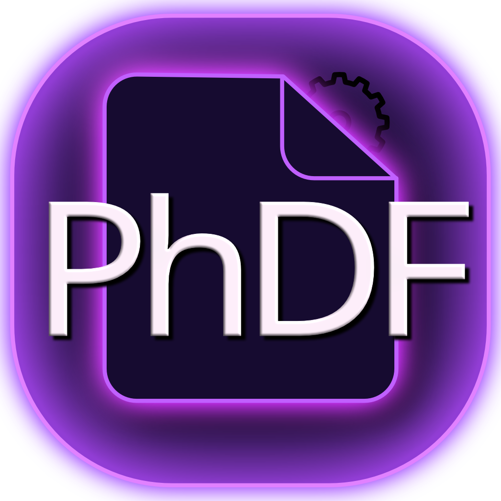

<p align="center"></p>

# PhDF

A lightweight, reader-first PDF app for heavy readers - with position memory, a built-in
Markdown editor, Obsidian integration, OCR, and a terminal-based AI side panel.

> **Status:** v0.8.0, in active development: book view and EPUB, PhDF Tools, printing,
> password-protected PDFs, themes and more settings. Windows is the main platform; macOS and
> Linux builds come from CI.

> **Beta:** PhDF may still crash now and then. Save your work regularly (Ctrl+S).

## What's new in 0.8.0

**New**
- **Image → AI**: drag a rectangle around a figure, table or passage and send it to the AI in
  the terminal with your question (AI tools menu next to ✦). The image file is deleted
  afterwards.
- **Save button** (floppy disk) in the toolbar, with a dot while something is unsaved. It saves
  the PDF's annotations, its note and its parking lot.
- **Select in several places**: hold Ctrl (⌘ on a Mac) and drag to add more parts to a
  selection; highlighting gives each part its own highlight.
- A beta notice in the ⋯ menu and Settings → About, with links to the GitHub page and to
  report a bug.

**Fixes**
- Two identical copies of a PDF no longer share one document (saving one could change the other).
- Closing a window always saves notes, typed grades and PhDF Tools work first (or asks).
- The same PDF open in several tabs or windows stays in sync.
- Grading: Ctrl+S saves the grade you typed; an exam is marked done only after it is saved.
- PhDF Tools: asks before switching files with unsaved changes, never overwrites the original,
  and undo works more reliably.
- A note changed in another app no longer overwrites what you typed meanwhile.
- The scrollbar starts below the toolbar, and a new version never shows the old interface.
- Updating with the installer removes the old version's files.

**Faster**
- Big PDFs open much faster (a 650-page book: 0.35 s → 0.02 s).
- Searching a long book no longer freezes page drawing.
- Splitting and extracting pages is many times faster; long thumbnail lists scroll smoother.
- A smaller app (only the font files that are used).

## Keyboard shortcuts

On macOS use ⌘ for Ctrl and ⌥ for Alt (the app shows them that way); ⌃⌘F is full screen and
⌘[ / ⌘] go back / forward.

| Action | Keys |
|---|---|
| Find any command | Ctrl+K |
| Open PDF or Markdown | Ctrl+O |
| Undo / redo annotations | Ctrl+Z / Ctrl+Y |
| Bookmark page | Ctrl+B |
| Copy with citation | Ctrl+Shift+C |
| Save annotations | Ctrl+S |
| New tab / close tab / next tab | Ctrl+T / Ctrl+W / Ctrl+Tab |
| Search (Enter next, Shift+Enter previous) | Ctrl+F |
| Go to page | Ctrl+G |
| Zoom in / out / actual size | Ctrl++ / Ctrl+- / Ctrl+0, or Ctrl+wheel |
| Back / forward (after links, outline, go-to) | Alt+← / Alt+→ |
| Previous / next page, first / last page | ← / →, Home / End |
| Toggle sidebar | Ctrl+\ |
| Zen mode / full screen | Ctrl+. / F11 |
| Parking lot (park a stray thought) | Ctrl+Shift+Space |
| Delete selected annotation | Delete |
| AI terminal | Ctrl+` |

**Tabs & panes:** drag a tab to reorder it; drop it on the left/right edge of a document to view
up to three side by side (drag the divider to resize); drop it outside the window to open it in a
new window.

**AI terminal:** Ctrl+` opens your shell in the PDF's folder above the note. The first time, it
asks for your **default AI agent** (Claude Code, Codex, Gemini CLI, or the command of any other terminal AI);
from then on new terminals start it by themselves (change it in the terminal's header or in
Settings). **+** in the header opens more terminals as tabs, each with its own shell. Drag its
header to dock it at the bottom, drag the divider to resize, click the header to fold it away. Select text → ✦ *Ask AI* to explain, summarize or translate it, or to ask your own
question; ✦ in the toolbar asks about the whole document, a chapter or a page. **▾ next to ✦ →
Equation → LaTeX**: drag a rectangle around an equation and the AI writes its LaTeX; check it in
the preview and insert it into the note at your cursor as `$$ … $$` (the note's Preview typesets
`$…$` / `$$…$$` math with KaTeX). The image is a temporary file in a hidden `.phdf-tmp` folder
where the terminal runs and is deleted as soon as the answer arrives. New to
terminal AIs? **How to** in the terminal's header shows how to install Claude Code, Codex or Gemini CLI for your OS. The
**?** button explains everything in the app.

**Read & Focus:** the *Read* menu (top left) turns on a reading ruler, zen mode, full screen
or a page tint - each on its own. *Focus* has a small pomodoro and shows how long the chapter
and the document will take at your reading pace (fast scrolling doesn't count). The lightbulb
(Ctrl+Shift+Space) parks a stray thought in `<book>.parking.md` next to the PDF; it shows up in the
**Parking** tab of the note panel.

**OCR, export & Obsidian:** scanned pages show a *Recognize Text* bar (language files are
downloaded on first use - no Tesseract install needed). The ⋯ menu exports the document as
Markdown (to a file or your Obsidian vault) and copies notes to Obsidian; *Send to Obsidian* in
the selection menu adds the quote to the book's note in your vault (set it in ⋯ → Settings).

**Grading:** the *Grade* button (top right, next to **?**) asks for a folder of exam PDFs (subfolders included, e.g. a
Moodle download) and opens them one by one. Mark them with any tool; **Done** saves and opens the
next one, **Prev** goes back, the sidebar's *Exams* list jumps anywhere. The originals are never
changed - the marked copies are saved in `graded/`. Beside the exam is the folder's grades table,
`<folder>.grades.md` (`# | Name | Grade | Comment`, add your own columns; names start empty). With *Automated* on, a
drawer asks who wrote each exam and the grade typed next to Done goes into the table; *CSV*
exports it.

**Annotations & notes:** select text to highlight / underline / strike it or send it to the
PDF's integrated note (**Note in MD**). The note is `<pdf name>.md` next to the PDF and opens beside
it in the same tab (drag a sticky note or text box to move it; click a drawing, then drag it;
text boxes have Sans / Serif / Mono, a size and bold); each quote starts with a pin like `⎘ phdf · p.12 · §2.1 · #k7q2` - click
**Go to PDF ↗** to jump to the highlight, or click the highlight to jump to its note.

## Upcoming features

Not scheduled yet - ideas waiting for their turn:

- `phdf://` links: click a quote's pin in Obsidian to open PhDF at that page
- Send quotes to the note that is open in Obsidian right now
- Double-click a word to have the AI explain it
- Turkish interface

## Stack

- **Backend:** Python 3.12 · [pywebview](https://pywebview.flowrl.com/) · [PyMuPDF](https://pymupdf.readthedocs.io/) · SQLite
- **Frontend:** Svelte 5 · TypeScript · Vite
- **Platforms:** Windows (primary), macOS and Linux (experimental)

## Development

Requirements: [uv](https://docs.astral.sh/uv/) and Node.js 20+.

```sh
# install dependencies
uv sync
npm --prefix frontend install

# option 1: run against the built frontend
npm --prefix frontend run build
uv run phdf

# option 2: hot reload - run the Vite dev server, then start the app in dev mode
npm --prefix frontend run dev
PHDF_DEV=1 uv run phdf          # PowerShell: $env:PHDF_DEV=1; uv run phdf
```

Settings like `PHDF_DEV` can also go in a `.env` file - copy `.env.example` to `.env`
(it is git-ignored).

Checks:

```sh
uv run ruff check . && uv run ruff format --check .
uv run pytest
npm --prefix frontend run check
```

Package a standalone app (output in `dist/PhDF/`):

```sh
npm --prefix frontend run build
uv run pyinstaller phdf.spec --noconfirm
```

Files can be passed on the command line (`phdf book.pdf notes.md`), which is also how
"Open with" works.

### macOS

The build is `dist/PhDF.app`. It is not signed yet, so the first time right-click it → **Open**
(or allow it in System Settings → Privacy & Security). The AI terminal starts your login shell
(zsh), so `claude` / `codex` are found as in Terminal.app.

### Linux

pywebview uses GTK + WebKit2 on Linux. Install the system packages first, e.g. on Debian/Ubuntu:

```sh
sudo apt install libgirepository-2.0-dev libcairo2-dev pkg-config gir1.2-webkit2-4.1
```

To get PhDF in the app menu and in "Open with" for PDFs, copy
`packaging/linux/phdf.desktop` to `~/.local/share/applications/` (it runs `phdf`, so the command
must be on your PATH). OCR needs one TrueType font (DejaVu, Liberation or Noto - found
automatically, also through `fc-match`).

## License

PhDF is free software, licensed under the [GNU Affero General Public License v3.0](LICENSE)
(or later). You may use, share and change it; if you share a changed version, share its source
code under the same license. Contributions require agreeing to the
[Contributor License Agreement](CLA.md).

PhDF is built on open-source software, listed with their licenses in
[THIRD_PARTY_NOTICES.md](THIRD_PARTY_NOTICES.md) (also in the app: Settings → About). What PhDF
does and doesn't do with your data: [PRIVACY.md](PRIVACY.md).

Windows release signing (starting once SignPath approves the project): free code signing provided by [SignPath.io](https://about.signpath.io),
certificate by [SignPath Foundation](https://signpath.org); see
[CODE_SIGNING_POLICY.md](CODE_SIGNING_POLICY.md).
